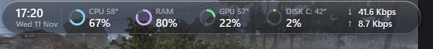
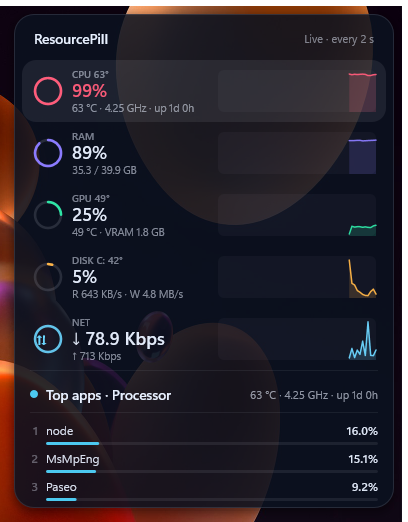
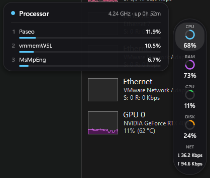

# ResourcePill

A tiny, always-on-top resource monitor for Windows, written in Rust (Win32 + Direct2D, no web runtime).
A pill-shaped bar shows CPU, RAM, GPU, disk and network; click any of them for the top 3 apps using it.



**[Download ResourcePill.exe](https://github.com/Clyde369/ResourcePill/releases/latest)** — a single ~0.5 MB file, nothing to install.

## Views

| Card (double-click the pill) | Docked to a screen edge |
|---|---|
|  |  |

On the hour a band of light sweeps across and the clock glows:


## Features

- **Accurate**: Task Manager's own data sources (kernel process snapshot, PDH counters, GPU engine counters, physical network adapters); every drive listed separately
- **Top 3 apps** for CPU, RAM, GPU and disk I/O; busiest adapters for network
- **Temperatures**: GPU (same source as Task Manager) and NVMe drives; in admin mode also the CPU (AMD Ryzen Master SDK) and SATA drives (SMART)
- **Views**: horizontal pill, vertical capsule when docked to a left/right edge, or a larger card with 60-second graphs
- **Clock** in your Windows time format, with an hourly animation
- **Themes**: Graphite, Midnight, OLED, Glass, Frost, Light, Sunset, Mono
- **Customisable** from the right-click menu: metrics, size, opacity, refresh rate, smoothing, animations, snap positions, click-through, start with Windows
- **Light**: about 0.1% CPU and ~15 MB RAM

## Use

- Drag to move: it snaps to edges, corners and centre, and never leaves the screen.
- Double-click switches between the pill and the card.
- `Ctrl+Alt+M` or the tray icon hides and shows it. Right-click for settings.
- **Admin mode** (right-click menu) adds CPU and SATA temperatures. It asks for administrator rights once, then starts at login through a scheduled task with no further prompts.
- `ResourcePill.exe --quit` closes a running copy.

## Build

Requires Rust (MSVC toolchain) on Windows 10/11.

```
cargo build --release
```

CPU temperature needs the [AMD Ryzen Master SDK](https://www.amd.com/en/products/software/ryzen-master.html) installed (`C:\Program Files\AMD\RyzenMasterSDK`) when building and running. Without it the app builds and runs normally, just without CPU temperature. No AMD files are included in this repository.

## License

[MIT](LICENSE)
