# Peter the Pill (ResourcePill)

A tiny, always-on-top pill for Windows, written in Rust (Win32 + Direct2D, no web runtime).
It shows CPU, RAM, GPU, disk and network, controls your music and volume, and records and transcribes meetings on your own PC.


**[Download ResourcePill.exe](https://github.com/Clyde369/ResourcePill/releases/latest)**: one file, nothing to install.

## How it works

### 1. Install

Download the exe and double-click it. Windows SmartScreen may warn about an unknown app: click **More info → Run anyway**.
Everything it needs is inside that one file and unpacks itself to `%LOCALAPPDATA%\ResourcePill` on first run.

### 2. First launch: it gets transcription ready by itself

The required speech models (about 570 MB, once) start downloading straight away. The strip under the pill shows progress.

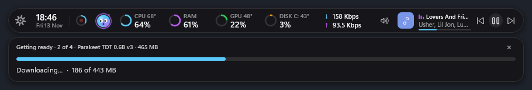

### 3. The setup guide

A short guide opens with it. You can reopen it any time from **⚙ → Transcription → Setup guide**.

| Welcome | Speech to text |
|---|---|
| 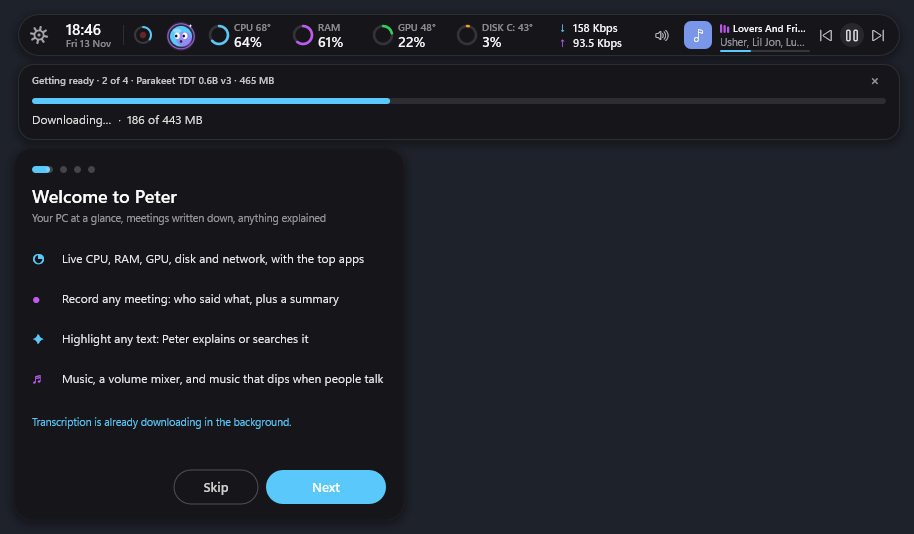 | 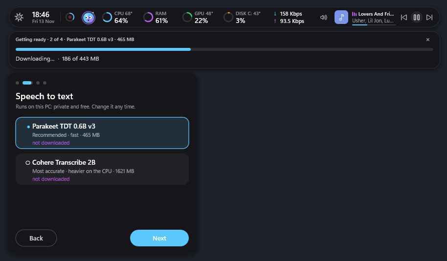 |
| **Meeting summaries** | **Your recordings** |
| 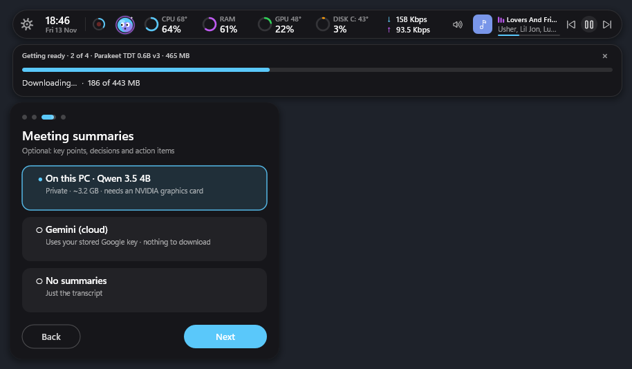 | 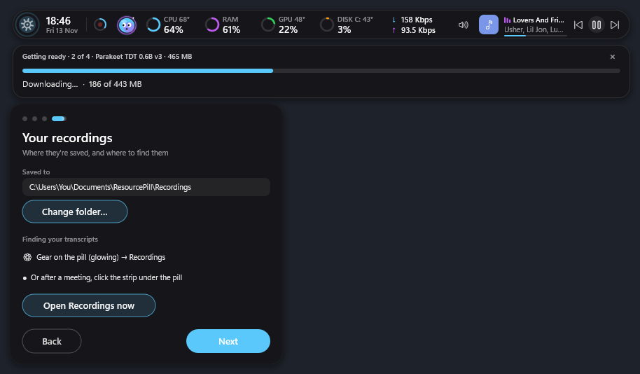 |
| **Getting ready** | |
| 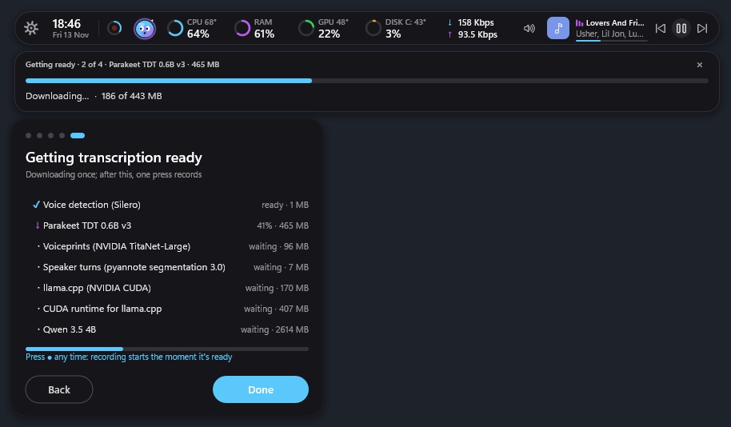 | |

- **Speech to text**: local (free, private) or Gemini with your own API key.
- **Your recordings**: pick where recordings and transcripts are saved (**Change folder…**). Change it later in **⚙ → Transcription → Recordings folder…**

### 4. Record with one press

Press **●** on the pill (or `Ctrl+Alt+R`). If the models are still downloading, it waits and starts recording by itself when they're ready.

| Pressed while downloading | Ready |
|---|---|
| 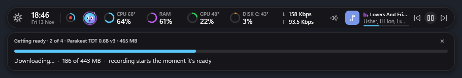 | 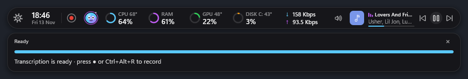 |

While recording, the live transcript appears under the pill with each speaker labelled:

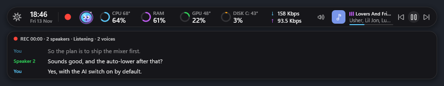

### 5. Find your transcripts

Every recording, transcript and summary is in one window:

- **⚙ (gear on the pill) → Recordings**, or
- after a meeting, click the strip under the pill.

The files are also in your recordings folder (default `Documents\ResourcePill\Recordings`).

## Features

| Music player (any app: Spotify, YouTube, …) | Volume mixer |
|---|---|
| 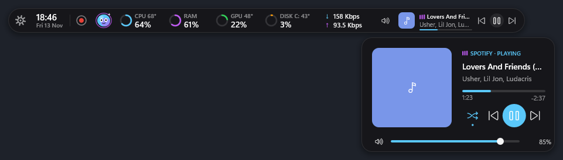 | 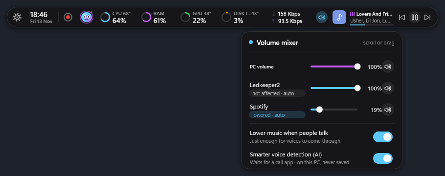 |

- **Music**: play/pause, previous/next and progress right on the pill. Click the song for the full player, with volume. No sign-in, it uses Windows media controls.
- **Volume mixer**: every app's volume in one place. Click the speaker icon on the pill.
- **Watch & browse under the pill** (`Ctrl+Alt+Y`, or **⚙ → Watch & browse under the pill**): a small browser docked under the pill that follows it around. Paste a YouTube or Twitch link and it plays in the player, with live chat beside or over the video. Or type any address or a search; sites you sign in to stay signed in. A YouTube or Twitch link already on the clipboard plays straight away. Drag its edges to resize. To keep it out of the way: make it see-through, turn on **Ghost** (clicks go through it and it fades while the mouse is over it; `Ctrl+Alt+G` turns it on and off from anywhere, or hold `Ctrl` over it to use it), or hide it with `Ctrl+Alt+Y` while the sound keeps playing. YouTube videos that only allow playing on YouTube open YouTube's own page, showing just the player. Full screen fills just the window. Ad blocker or other browser extensions: put the unpacked extension folder (e.g. uBlock Origin's `uBlock0.chromium`) in `%LOCALAPPDATA%\ResourcePill\extensions`; it loads the next time the window opens, and deleting the folder turns it off. Uses Microsoft Edge WebView2, which is built into Windows 11.
- **Lower music when people talk**: when someone speaks on Discord, a call or a video, your music dips smoothly and comes back after. Optional AI voice detection runs on your PC. A badge on the pill shows which app it's lowering for.

  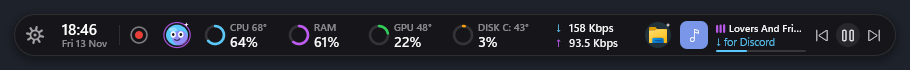

- **Cover colours**: the pill picks up a moving gradient from the song cover.

  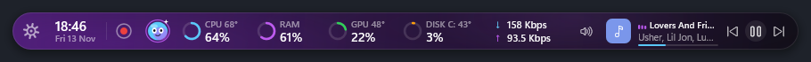

- **Keyboard status**: shows whether your keyboard is connected by Bluetooth, by cable, or disconnected.

  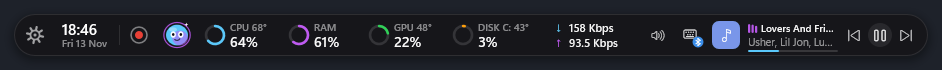

- **Explain mode**: highlight text anywhere and ask Peter to explain or search it (local or Gemini).
- **Edge tuck**: drag the pill against a screen edge to tuck it away, tap the edge to bring it back.
- **Accurate stats**: Task Manager's own data sources. Top 3 apps for CPU, RAM, GPU and disk; temperatures for GPU and NVMe (CPU and SATA in admin mode).
- **Views**: pill, vertical capsule when docked to a side, or a card with 60-second graphs (double-click).
- **Themes**: Graphite, Midnight, OLED, Glass, Frost, Light, Sunset, Mono.
- **Performance**: High / Medium / Low and 15–60 fps. Low uses almost nothing and turns off animations.

| Card | Docked to a side | Settings |
|---|---|---|
| 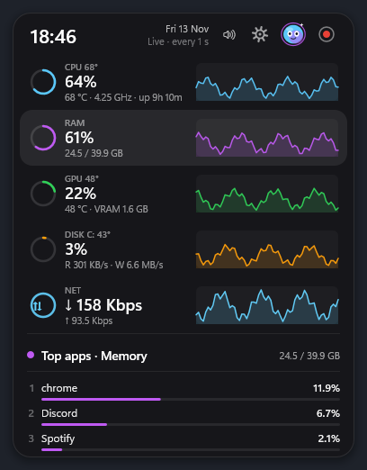 | 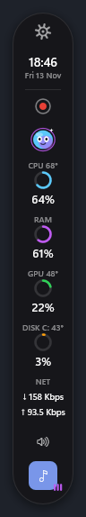 | 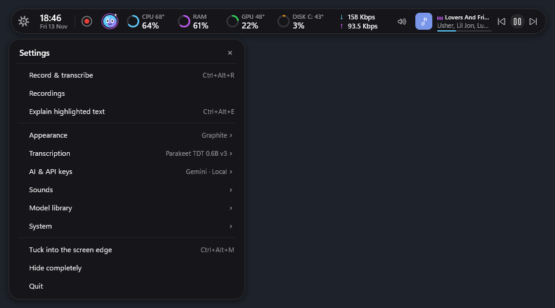 |

## Use

- Drag to move: it snaps to edges, corners and centre, and never leaves the screen.
- Double-click switches between the pill and the card.
- `Ctrl+Alt+M` or the tray icon hides and shows it. Click the gear or right-click for settings.
- **Admin mode** (settings) adds CPU and SATA temperatures. It asks for administrator rights once, then starts at login through a scheduled task.
- `ResourcePill.exe --quit` closes a running copy.

## Build

Requires Rust (MSVC toolchain) on Windows 10/11.

```
cargo build --release
```

`target\release\resource-pill.exe --make-bundle "Peter the Pill.exe"` packs the app and the transcription helper into one exe.
To publish an update that running copies offer under **New update available** (they check about once a day):
1. Bump `version` in the root `Cargo.toml` (e.g. `0.2.0`), then `cargo build --release --workspace` and `--make-bundle ResourcePill.exe`.
2. Create a GitHub release tagged `v0.2.0` (same number, with a `v`) and attach that `ResourcePill.exe`. Don't mark it a pre-release.
3. The app installs it only if its SHA-256 matches the digest GitHub shows for the asset, so upload the exact file.

`resource-pill.exe --snapshots <folder>` renders every view to PNGs (that's how the screenshots above are made).

CPU temperature needs the [AMD Ryzen Master SDK](https://www.amd.com/en/products/software/ryzen-master.html) installed (`C:\Program Files\AMD\RyzenMasterSDK`) when building and running. Without it the app works normally, just without CPU temperature. No AMD files are included in this repository.

## License

[MIT](LICENSE)
